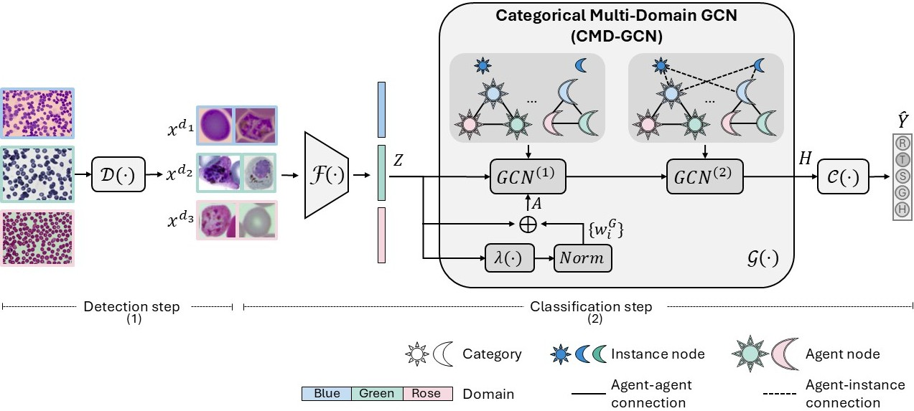

# Categorical Multi-Domain Graph Convolutional Network (CMD-GCN) for Plasmodium Life Cycle Development Classification

Repository for the the paper "CMD-GCN: Categorical Multi-domain Graph Convolutional Network for Plasmodium Development Stage Recognition". The paper is available [here](https://doi.org/10.1007/978-3-032-31936-4_10). 

## Overall framework

CMD-GCN is a module placed on top of feature extractor using GCN to enhance feature representation by information integration across categories while preserve unique information of each category in each domain.



## Dataset

We use three datasets for training, namely [BBBC041](https://bbbc.broadinstitute.org/BBBC041/), [IML Malaria](https://www.kaggle.com/datasets/qaziammararshad/iml-malaria/data), and RecoPlasmodiumV1.

## Experiment Design

Two baselines and two approaches with MDIF are experimented:
 - Individual Training (baseline 1): model is trained on individual dataset without MDIF.
 - Joint Training (baseline 2): model is trained jointly on all datasets without MDIF.
 - MDIF: model is trained jointly on all datasets with MDIF.
 - CMD-GCN: model is trained jointly on all datasets with CMD-GCN.

## How to run experiment? 

Some requirements for running environment includes: PyTorch 2.1.2, Torchvision 0.16.2, mmcv 2.1.0, mmengine

A config file with specific settings, such as dataset and components of model, should be defined to run the experiments. Examples of training and evalution with MDIF in Kaggle are shown as following.

Training:
```shell
python tools/train.py /kaggle/input/configs-file/approach2_7class/approach2.1_all_7classes_weightedsampling_kaggle_Dec10.py
```
Evaluation: 
```shell
python tools/test.py /kaggle/input/configs-file/approach2_7class/approach2.1_all_7classes_weightedsampling_kaggle_Dec10.py /kaggle/working/experiment_result/epoch_50.pth
```

All config files to reproduce experiment results is available at [Kaggle dataset](https://www.kaggle.com/datasets/khanhtq2101/configs-file)

Example of setting environment and running on Kaggle: [Individual Training BBBC041](https://www.kaggle.com/code/quockhanh01/baseline1-bbbc041-mmpretrain?scriptVersionId=212608647)
